# codeart

**Generative art from code: describe a picture with a few settings, press run, get a print-ready image.**

codeart turns mathematical noise, light and geometry into high-resolution artworks. You do not
need to be a programmer: every artwork is made by changing a handful of plain settings, such as
colours, size and shape, and running one line. The same settings always give the same picture,
so you can explore freely and come back to a favourite later.

<p align="center">
  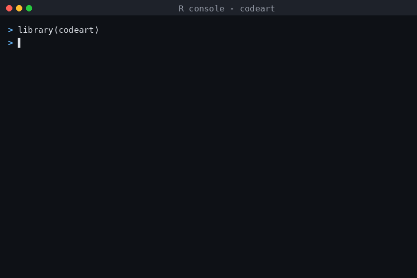
</p>

<p align="center"><em>One line of R per artwork: Pin-field, Silk flow, Crystal shards, Iso cubes, Wire flow.</em></p>

---

## Contents

1. [The five styles](#the-five-styles)
2. [Getting started (first-time setup)](#getting-started)
3. [Your first artwork](#your-first-artwork)
4. [How a recipe works](#how-a-recipe-works)
5. [Colours and palettes](#colours-and-palettes)
6. [Size, shape and resolution](#size-shape-and-resolution)
7. [Signing your work (watermark)](#signing-your-work)
8. [Exploring: seeds, drafts and batches](#exploring-seeds-drafts-and-batches)
9. [Style guides: the settings that matter](#style-guides)
10. [Tips for print and social media](#tips-for-print-and-social-media)
11. [Troubleshooting](#troubleshooting)
12. [Glossary](#glossary)
13. [For developers](#for-developers)

---

## The five styles

| | Style | What it looks like | Made with |
|---|---|---|---|
| 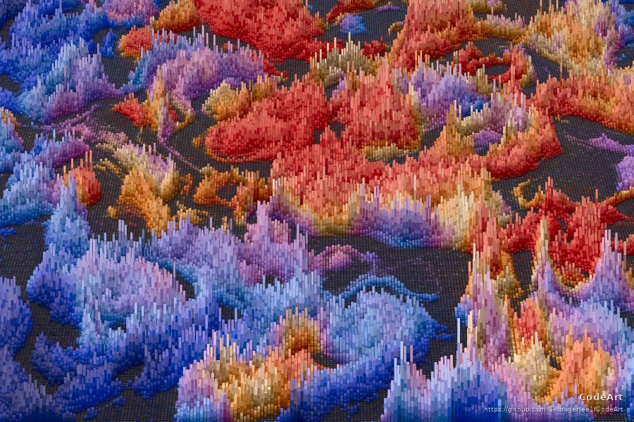 | **Pin-field** | A landscape built from thousands of thin glowing pins, seen from above at an angle, like a coral reef or a city of light | `render_pinfield()` |
| 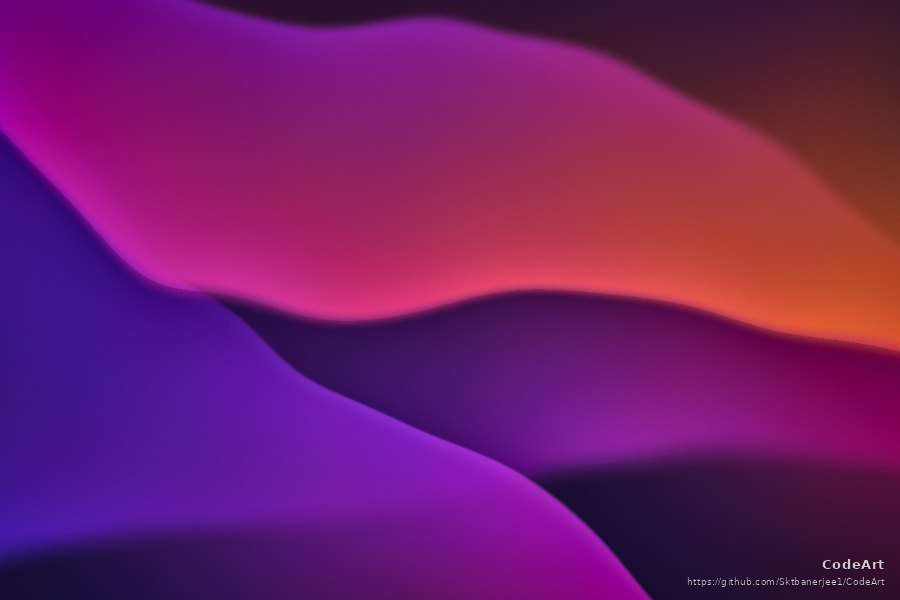 | **Silk flow** | Soft ribbons of colour folding over each other, with crisp edges, glow and film grain | `render_silk()` |
| 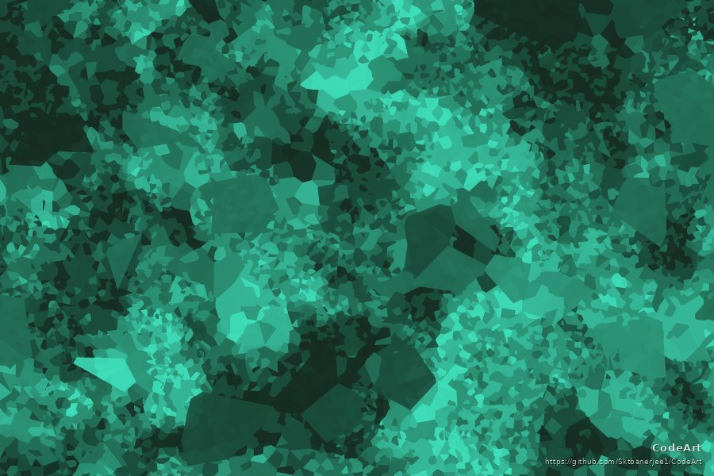 | **Crystal shards** | Layers of flat polygonal shards, from large to tiny, clustering into light and dark areas | `render_shards()` |
| 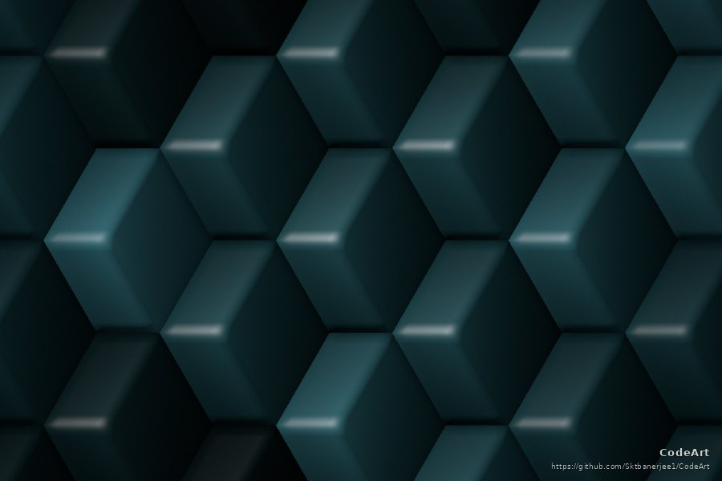 | **Iso cubes** | A wall of glossy rounded blocks under a spotlight, with soft highlights on their edges | `render_cubes()` |
| 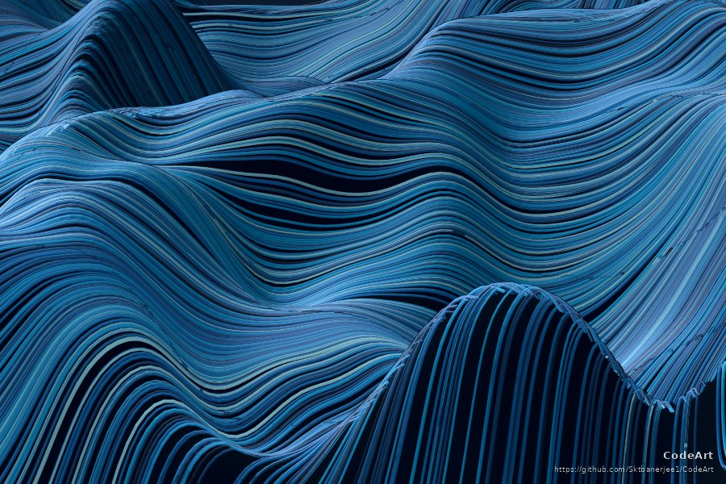 | **Wire flow** | Hundreds of fine glossy wires flowing like combed hair over smooth hills, under a dark sky | `render_wires()` |

---

## Getting started

You only do this once.

**1. Install R and RStudio (both free).**
- R, the engine: <https://cloud.r-project.org>
- RStudio, the friendly window you work in: <https://posit.co/download/rstudio-desktop/>

**2. Install codeart.** The package lives on GitHub at
**<https://github.com/Sktbanerjee1/CodeArt>**. Open RStudio, click into the **Console** (the panel
with the `>` prompt), paste these two lines and press Enter:

```r
install.packages("remotes")
remotes::install_github("Sktbanerjee1/CodeArt")
```

This downloads codeart from the repository above together with everything it needs
(ambient, deldir, farver, ragg). If R asks whether to update other packages, typing `1`
(All) or `3` (None) are both fine.

To get the newest version later, run `remotes::install_github("Sktbanerjee1/CodeArt")` again.

<details>
<summary>Other ways to install</summary>

- **From a downloaded copy:** on <https://github.com/Sktbanerjee1/CodeArt> click
  **Code → Download ZIP**, unzip it, then run
  `remotes::install_local("path/to/the/unzipped/folder")`.
- **With Git:** `git clone https://github.com/Sktbanerjee1/CodeArt.git`, then
  `remotes::install_local("CodeArt")`.

</details>

**3. Load it** at the start of every session:

```r
library(codeart)
```

> **Tip:** In RStudio, use *File → New File → R Script* to keep your recipes in a file. Put the
> cursor on a line and press **Ctrl+Enter** (Windows/Linux) or **Cmd+Enter** (Mac) to run it.

---

## Your first artwork

```r
library(codeart)
render_silk()
```

That's it. After a short wait (seconds to a couple of minutes, depending on style and size) the
console shows a line like:

```
saved ./silk_flow_nebula_16x10.png  (nebula, 4800 x 3000 px, compute 2000 x 1250)
```

The image is saved in your **working folder**. To see where that is, run `getwd()`, or in
RStudio open the **Files** tab. To keep things tidy, send all images to a folder of your choice:

```r
render_silk(silk_params(out_dir = "my-art"))
```

Try the other three styles the same way:

```r
render_pinfield()
render_shards()
render_cubes()
render_wires()
```

---

## How a recipe works

Every artwork has two parts:

| Part | What it is | Example |
|---|---|---|
| **Settings** ("the recipe card") | A list of choices: colours, size, shapes, light | `silk_params(palette = "ocean")` |
| **Render** ("cook it") | Turns the settings into an image file | `render_silk(...)` |

Each style has its own pair:

| Style | Settings | Render |
|---|---|---|
| Pin-field | `pinfield_params()` | `render_pinfield()` |
| Silk flow | `silk_params()` | `render_silk()` |
| Crystal shards | `shards_params()` | `render_shards()` |
| Iso cubes | `cubes_params()` | `render_cubes()` |
| Wire flow | `wires_params()` | `render_wires()` |

You only write the settings you want to **change**; everything else keeps its default.
Separate several changes with commas:

```r
render_silk(silk_params(palette = "sunset", aspect = "1:1", seed = 42))
```

You can also save a recipe under a name and reuse it:

```r
my_recipe <- silk_params(palette = "sunset", aspect = "4:5", W = 8, out_dir = "my-art")
render_silk(my_recipe)
```

To see every setting a style offers (and its default value):

```r
str(silk_params())     # a quick list
?silk_params           # the help page, with explanations
```

> **Typo protection:** if you misspell a setting, codeart stops and lists the correct names,
> e.g. `silk_params(pallete = "ocean")` → *unknown parameter(s): pallete*.

---

## Colours and palettes

Every style comes with ready-made colour schemes. **Pin-field** and **Silk flow** use named
palettes. **Crystal shards**, **Iso cubes** and **Wire flow** have two colour modes:

| Mode | What you get | How to choose |
|---|---|---|
| **Mono** | Shades of a single colour, from deep shadow to light | `palette_mode = "mono", mono = "cobalt"`, or **any colour as a hex code**, e.g. `mono = "#E0457B"` |
| **Multi** | A hand-picked set of several colours | `palette_mode = "multi", multi = "tropical"` |

Mono presets (shards, cubes, wires): `steel_teal` · `teal` · `emerald` · `cobalt` · `violet` · `crimson` · `amber` · `rose` · `slate` · `silver`

Multi palettes (shards, cubes, wires): `jade_night` · `tropical` · `sunset` · `ocean` · `forest` · `ember` · `berry` · `desert` · `neon` · `slate_accent`

### Pin-field

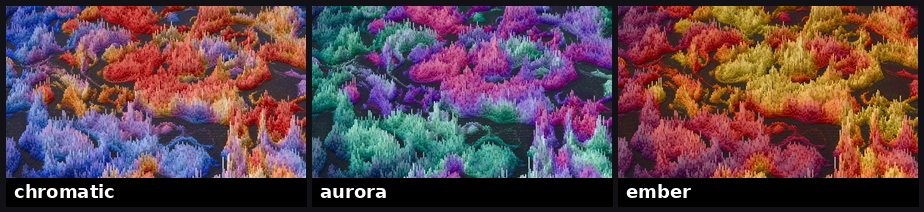

Three palettes, from cool edges to a warm core.

Palettes: `chromatic` · `aurora` · `ember`

```r
render_pinfield(pinfield_params(palette = "aurora"))
```

### Silk flow

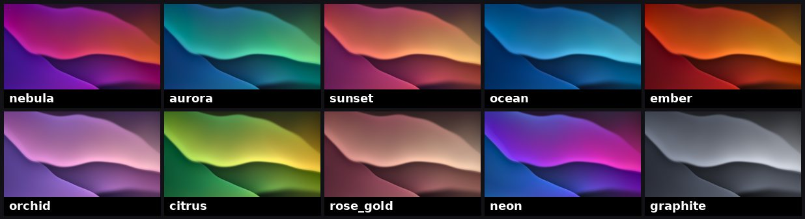

Ten palettes, each with its own deep background tone.

Palettes: `nebula` · `aurora` · `sunset` · `ocean` · `ember` · `orchid` · `citrus` · `rose_gold` · `neon` · `graphite`

```r
render_silk(silk_params(palette = "citrus"))
```

### Crystal shards

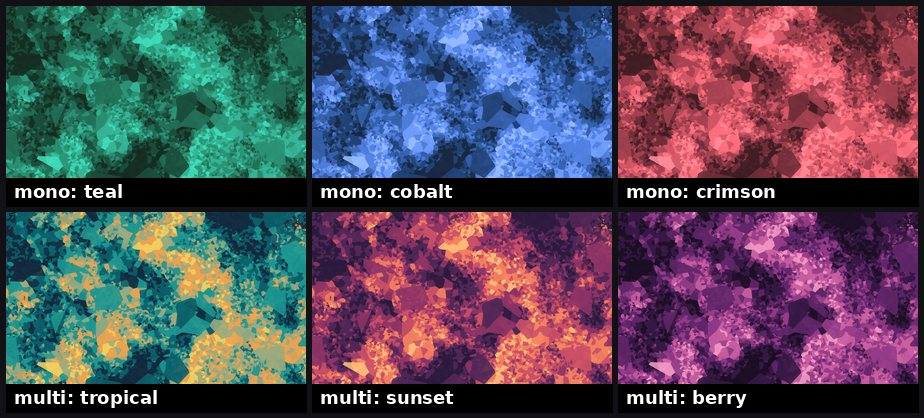

Top row: mono `teal`, `cobalt`, `crimson`. Bottom row: multi `tropical`, `sunset`, `berry`.

Colours: any mono preset or hex code, or any multi palette (lists above).

```r
render_shards(shards_params(palette_mode = "mono", mono = "cobalt"))
render_shards(shards_params(palette_mode = "multi", multi = "tropical"))
```

### Iso cubes

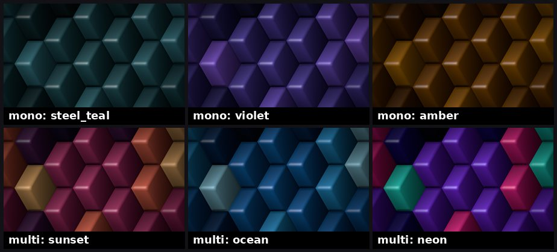

Top row: mono `steel_teal`, `violet`, `amber`. Bottom row: multi `sunset`, `ocean`, `neon`.

Colours: any mono preset or hex code, or any multi palette (lists above).

```r
render_cubes(cubes_params(palette_mode = "mono", mono = "violet"))
render_cubes(cubes_params(palette_mode = "multi", multi = "ocean"))
```

### Wire flow

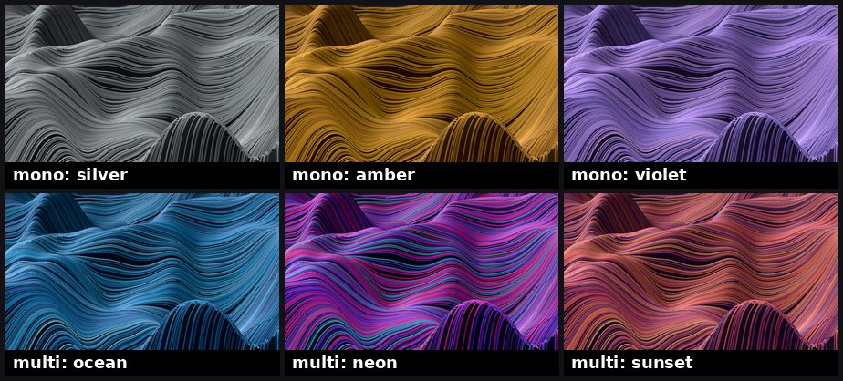

Top row: mono `silver`, `amber`, `violet`. Bottom row: multi `ocean`, `neon`, `sunset`.

Colours: any mono preset or hex code, or any multi palette (lists above). The sky takes a dark tint of the palette automatically; set your own with `bg = "#0E1B1E"`.

```r
render_wires(wires_params(palette_mode = "mono", mono = "amber"))
render_wires(wires_params(palette_mode = "multi", multi = "neon"))
```

### Number of tones

For shards, cubes and wires, `n_tones` sets how many colour steps are used: fewer gives a bold,
poster-like look; more gives smoother shading.

```r
render_shards(shards_params(mono = "violet", n_tones = 4))
```

### Previewing colours before rendering

```r
list_palettes()                                    # all palette names, by style
preview_colours(SILK_PALETTES$sunset$ramp)         # show a silk palette as swatches
preview_colours(tone_palette("mono", "#E0457B", n = 6))   # the shades of your own colour
```

---

## Size, shape and resolution

Three settings control the image size:

| Setting | Meaning | Example |
|---|---|---|
| `aspect` | Shape, as width:height | `"16:9"`, `"1:1"`, `"4:5"`, `"9:16"`, `"210:297"` (A4) |
| `W` | Width in inches; the height follows from the shape | `16` |
| `dpi` | Pixels per inch | `300` for print |

**Pixel size = `W × dpi` wide.** For example, `W = 16, dpi = 300` gives an image 4800 pixels wide.

Ready-made sizes:

| Use | Settings | Result (pixels) |
|---|---|---|
| Instagram portrait post | `aspect = "4:5", W = 3.6, dpi = 300` | 1080 × 1350 |
| Instagram / TikTok story, phone wallpaper | `aspect = "9:16", W = 3.6, dpi = 300` | 1080 × 1920 |
| Square post | `aspect = "1:1", W = 3.6, dpi = 300` | 1080 × 1080 |
| 4K desktop wallpaper | `aspect = "16:9", W = 12.8, dpi = 300` | 3840 × 2160 |
| A4 print | `aspect = "210:297", W = 8.27, dpi = 300` | 2481 × 3508 |
| A3 print | `aspect = "297:420", W = 11.69, dpi = 300` | 3507 × 4960 |
| Large print (default) | `aspect = "16:9", W = 16, dpi = 300` | 4800 × 2700 |

```r
render_cubes(cubes_params(aspect = "4:5", W = 3.6))
```

The composition adapts to the shape: portrait formats get more rows of pins, cubes or shards
rather than a stretched picture.

**Sharper silk and cubes.** These two styles are painted on an internal canvas and then
enlarged smoothly. For the crispest large prints, raise `compute_px` (default `2000`) toward the
final pixel width, for example `compute_px = 4800`. It takes longer and needs more memory.

---

## Signing your work

Every image carries a small two-line watermark in the bottom-right corner: **CodeArt** in bold,
with the project address **https://github.com/Sktbanerjee1/CodeArt** underneath, so people who
see your art can find the tool that made it.

### Rendering without the watermark

There are three ways, depending on how much you want to switch off:

| You want | Do this |
|---|---|
| One image without watermark | Add `clean = TRUE` to the render call. The file name gets `_clean`, so it never overwrites the signed version. |
| A recipe that is always clean | Put `watermark = watermark_params(enabled = FALSE)` in the settings. |
| Nothing watermarked for the rest of the session | Run `set_watermark(FALSE)` once, at the top of your script. |

```r
# one image
render_silk(silk_params(palette = "ocean"), clean = TRUE)
# -> silk_flow_ocean_16x10_clean.png

# one recipe
clean_recipe <- cubes_params(watermark = watermark_params(enabled = FALSE))
render_cubes(clean_recipe)

# the whole session (run this first, then build your recipes)
set_watermark(FALSE)
render_wires()
set_watermark(TRUE)        # switch it back on
```

> `set_watermark()` affects recipes created **after** you call it. A recipe saved earlier
> keeps the watermark setting it was made with.

### Changing the text or the look

```r
# your own caption under "CodeArt", for the whole session
set_watermark(TRUE, caption = "Your Name")

# a different look for one image
render_silk(silk_params(
  watermark = watermark_params(position = "top-left", alpha = 0.5, size = 0.025)
))
```

| Watermark setting | Meaning |
|---|---|
| `enabled` | `TRUE` to draw it, `FALSE` for a clean image |
| `caption` | Second line (default: the project address) |
| `label` | Bold first line (default: `CodeArt`) |
| `position` | `"bottom-right"`, `"bottom-left"`, `"top-right"`, `"top-left"` |
| `size` | Text size as a share of the image height (`0.02` = 2%) |
| `alpha` | Opacity, from `0` (invisible) to `1` (solid) |
| `colour` | Text colour, e.g. `"#FFFFFF"` |

---

## Exploring: seeds, drafts and batches

**Seeds.** The `seed` is the number behind the composition. The same seed always gives the same
picture; a different seed gives a new arrangement with the same style and colours.

```r
render_shards(shards_params(seed = 7))
```

**Fast drafts.** While exploring, render small and quick, then do the final at full size:

```r
draft <- silk_params(W = 6, dpi = 100, compute_px = 800, out_dir = "drafts")
render_silk(draft)
```

**Batches.** `render_variants()` renders every combination you list. Each file gets its own
name, so nothing is overwritten:

```r
# every silk palette
render_variants(render_silk, silk_params(out_dir = "my-art"), palette = names(SILK_PALETTES))

# six seeds as quick drafts, to pick a composition
render_variants(render_silk, draft, seed = c(3, 7, 42, 101, 2025, 4242))

# every mono colour for cubes, without watermark
render_variants(render_cubes, cubes_params(), mono = names(MONO_COLOURS), clean = TRUE)

# combinations: 3 seeds x 2 colours = 6 images
render_variants(render_shards, shards_params(), seed = 1:3, mono = c("teal", "rose"))
```

Then render your favourite at full size by copying its seed into your final recipe.

A ready-made script with many examples ships with the package:

```r
file.edit(system.file("examples", "gallery.R", package = "codeart"))
```

---

## Style guides

Each table lists the settings that change the look the most. Try one change at a time.

### Pin-field: `pinfield_params()`

| Setting | What it changes | Default | Try |
|---|---|---|---|
| `palette` | Colour scheme | `"chromatic"` | `"aurora"`, `"ember"` |
| `sea` | How much dark "valley floor" shows | `0.40` | `0.25` (more land), `0.5` (islands) |
| `spike` | Tall needle-like pins | `0.9` | `0.3` (calm), `1.5` (spiky) |
| `ridge_mix` | Crystalline texture on the crests | `0.55` | `0.2` (smooth), `0.8` |
| `gamma` | Peak shape: higher = sharper peaks | `1.4` | `1.0`, `2.0` |
| `warp` | How swirly the landforms are | `0.45` | `0.2`, `0.8` |
| `hue_freq` | Size of the colour zones (lower = bigger) | `1.1` | `0.6`, `2.0` |
| `core_bias` | Warm colours in the centre (negative flips it) | `0.9` | `0`, `-0.9` |
| `tip_strength` | White glow at the pin tips | `0.85` | `0.5`, `1.0` |
| `nx`, `ny` | Number of pins (more = finer and slower) | `300` | `200` (fast), `450` |

### Silk flow: `silk_params()`

| Setting | What it changes | Default | Try |
|---|---|---|---|
| `palette` | Colour scheme | `"nebula"` | any of the 10 |
| `n_sheets` | Number of ribbons | `4` | `3` (minimal), `6` (busy) |
| `flow_angle` | Main direction of the folds (in radians; 0 = horizontal) | `-0.35` | `0`, `0.6` |
| `amp` | How wavy the ribbons are | `0.16` | `0.08`, `0.25` |
| `edge` | Sharpness of the folds (smaller = crisper) | `0.003` | `0.001`, `0.01` |
| `width` | How far each ribbon fades | `c(0.18, 0.50)` | `c(0.1, 0.3)` |
| `shadow` | Darkness under each fold | `0.5` | `0.2`, `0.8` |
| `bloom` | Glow around bright areas | `0.35` | `0`, `0.6` |
| `grain` | Film grain | `0.010` | `0`, `0.02` |
| `vignette` | Darkened corners | `0.30` | `0`, `0.5` |

### Crystal shards: `shards_params()`

| Setting | What it changes | Default | Try |
|---|---|---|---|
| `palette_mode`, `mono`, `multi` | Colours (see above) | mono `"teal"` | multi `"desert"` |
| `n_tones` | Number of colour steps | `6` | `3`, `8` |
| `size` | Shard size, largest and smallest | `c(0.14, 0.012)` | `c(0.25, 0.03)` (chunky) |
| `n_layers` | Layers of shards | `6` | `3`, `8` |
| `cluster` | 0 = small shards scattered, 1 = in tight patches | `0.6` | `0.2`, `0.9` |
| `overlay` | Large shards on top of the detail | `0.12` | `0`, `0.3` |
| `alpha` | See-through-ness of the upper layers | `0.88` | `0.6`, `1` |
| `tone_random` | 0 = colours follow light/dark areas, 1 = random | `0.35` | `0`, `0.8` |
| `tone_gamma` | Above 1 = darker overall, below 1 = lighter | `1.25` | `0.8`, `1.6` |

### Iso cubes: `cubes_params()`

| Setting | What it changes | Default | Try |
|---|---|---|---|
| `palette_mode`, `mono`, `multi` | Colours (see above) | mono `"steel_teal"` | mono `"amber"` |
| `cube_size` | Block size (share of image height) | `0.16` | `0.10`, `0.25` |
| `elongation` | Block shape: 1 = perfect cubes, higher = taller | `1.7` | `1`, `2` |
| `bevel` | How rounded the edges are | `0.20` | `0.1`, `0.35` |
| `spacing` | 1 = touching, above 1 = gaps between blocks | `1` | `1.05`, `1.15` |
| `yaw`, `pitch` | Turn the blocks (degrees) | `0`, `0` | `8`, `-6` |
| `specular`, `shininess` | Gloss strength and highlight sharpness | `0.40`, `16` | `0.7`, `40` |
| `spot_x`, `spot_y`, `spot_r` | Spotlight position and size | `0`, `0`, `0.42` | `-0.5`, `0.2`, `0.3` |
| `spot_floor` | Brightness at the dark edges | `0.20` | `0.05` (dramatic), `0.6` (even) |
| `tone_random` | 0 = colour regions, 1 = random colour per block | `0.5` | `0`, `1` |

> If you push `yaw`, `pitch` or `elongation` far and see holes, add `search = 2`.

### Wire flow: `wires_params()`

| Setting | What it changes | Default | Try |
|---|---|---|---|
| `palette_mode`, `mono`, `multi` | Colours (see above); the darkest tone colours the surface under the wires | mono `"silver"` | multi `"ocean"`, mono `"amber"` |
| `bg` | Sky colour; `NULL` picks a dark tint of the palette | `NULL` | `"#0E1B1E"` |
| `n_wires`, `wire_width` | How many wires and how thick | `1200`, `0.25` | `600`, `0.4` (bold) / `2000`, `0.18` (fine) |
| `swirl`, `flow_freq` | How much the wires bend, and the size of the swirls | `1.9`, `0.5` | `0.8` (calm), `3` (wild) |
| `flow_angle` | Main direction of the flow (radians) | `0.25` | `0`, `0.8` |
| `freq`, `contrast`, `h_scale` | Size, steepness and height of the mound | `0.25`, `0.6`, `70` | `0.15` (one big hill), `0.4` (rolling hills) |
| `zoom`, `pan` | Close-up factor and sideways shift of the camera | `1.7`, `0` | `1.2` (wide), `2.5` (close), `pan = 0.2` |
| `row_gap` | Camera tilt: higher looks more from above | `0.62` | `0.45`, `0.9` |
| `end_lift`, `end_len` | Lift the wire ends off the surface (off by default) | `0`, `0.12` | `0.02`, `0.15` |
| `highlight` | Shine along each wire | `0.5` | `0.2`, `0.8` |
| `steps` | Length of each wire | `260` | `120` (short strands), `400` |

> More wires and longer wires take longer to draw. For drafts use `n_wires = 400`.

---

## Tips for print and social media

- **Print at 300 dpi.** Set `W` to the printed width in inches (A4 = 8.27, A3 = 11.69,
  12×18 in poster = 12) and the `aspect` to match the paper.
- **Silk and cubes for large prints:** raise `compute_px` (e.g. `4000`–`4800`) for crisper edges.
- **Pin-field for large prints:** raise `nx` (e.g. `400`) for finer pins; renders take longer.
- **Social media:** use the ready-made sizes above; upload the PNG as-is.
- **Dark backgrounds** look best on screens; for paper, try lighter palettes (`orchid`,
  `rose_gold`, `desert`, mono `slate`), or raise `spot_floor` for cubes.
- **Keep your recipes.** Save the settings of every image you like in a script; the same
  settings and seed recreate the same picture.

---

## Troubleshooting

| Message or problem | What it means / what to do |
|---|---|
| `could not find function "render_silk"` | Run `library(codeart)` first. |
| `unknown parameter(s): ...` | A setting name is misspelled; the message lists the valid names. |
| `palette must be one of: ...` | The palette name is not in the list; check spelling (`rose_gold`, not `rose gold`). |
| `aspect must look like "16:9"` | Write the shape with a colon and quotes: `aspect = "4:5"`. |
| `cannot allocate vector of size ...` | Not enough memory: lower `compute_px` (silk, cubes) or `nx`/`ny` (pin-field). |
| It takes very long | Use draft settings (`W = 6, dpi = 100`, lower `compute_px`) while exploring. |
| I can't find the image | It is in `getwd()`, or in the folder you set with `out_dir`. |
| The watermark text is wrong, or still shows after `set_watermark(FALSE)` | `set_watermark()` only affects recipes made after it. Call it first, then create the settings (e.g. `silk_params()`), then render. |
| Holes or gaps in cubes | Add `search = 2` to `cubes_params()`. |
| Wire flow shows a lot of empty sky | Raise `zoom` or `row_gap`, or try another `pan` or `seed`; taller formats (4:5, 9:16) fill with terrain automatically. |

---

## Glossary

| Word | Meaning |
|---|---|
| **Seed** | A number that fixes the random choices; same seed = same picture. |
| **Aspect ratio** | The shape of the image, width:height (16:9 is wide, 9:16 is tall, 1:1 square). |
| **dpi** | Dots (pixels) per inch; 300 is standard for print, 72–150 is enough for screens. |
| **Palette** | A set of colours used together. |
| **Hex code** | A colour written as `#RRGGBB`, e.g. `#E0457B`; any colour picker shows it. |
| **Mono / multi** | Shades of one colour / several different colours. |
| **Render** | Calculating the image and saving it as a file. |
| **Clean** | The same image without the watermark (`clean = TRUE`). |

---

## For developers

<details>
<summary>Package layout, tests and adding a style</summary>

```
R/
  codeart-package.R   package doc + imports
  utils.R             aspect parsing, blur, colour-space helpers, params merge, file naming
  canvas.R            ragg device setup, render report
  watermark.R         watermark_params(), set_watermark(), drawing
  palettes.R          palette presets, tone_palette(), list/preview helpers
  pinfield.R          pinfield_params(), render_pinfield()
  silk.R              silk_params(), render_silk()
  shards.R            shards_params(), render_shards()
  cubes.R             cubes_params(), render_cubes()
  wires.R             wires_params(), render_wires()
  variants.R          render_variants()
man/figures/          README images and demo GIF (built from tools/readme_figures.R renders)
tools/                readme_figures.R: renders every README image (not part of the package build)
tests/testthat/       parameter + tiny render tests
inst/examples/        gallery.R
inst/legacy/          the original standalone scripts
```

Development loop:

```r
devtools::document()   # rebuild help pages and NAMESPACE
devtools::test()       # run the tests
devtools::install()    # install locally
```

**Adding a style:** write `<style>_params()` (style defaults combined with `common_defaults()`
via `merge_params()`) and `render_<style>()`, which calls `output_path()`, draws on
`open_canvas()`, then `draw_watermark()` and `report()`, and returns the file path invisibly.
Add a test in `tests/testthat/test-render.R` and a section to this README.

Dependencies: [ambient](https://cran.r-project.org/package=ambient) (noise),
[deldir](https://cran.r-project.org/package=deldir) (Voronoi tiles),
[farver](https://cran.r-project.org/package=farver) (colour spaces),
[ragg](https://cran.r-project.org/package=ragg) (high-quality PNG output).

</details>

---

## License

MIT © Saikat Bandyopadhyay. See `LICENSE`.
